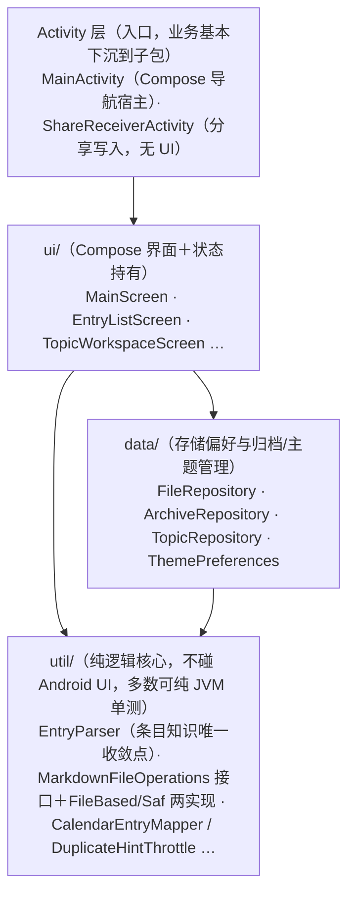
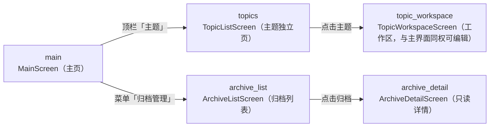
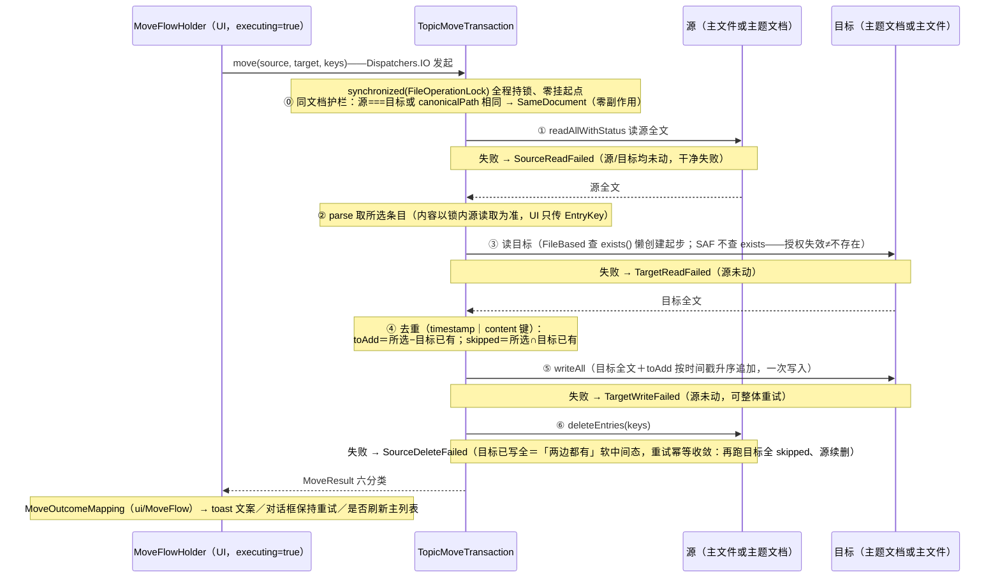
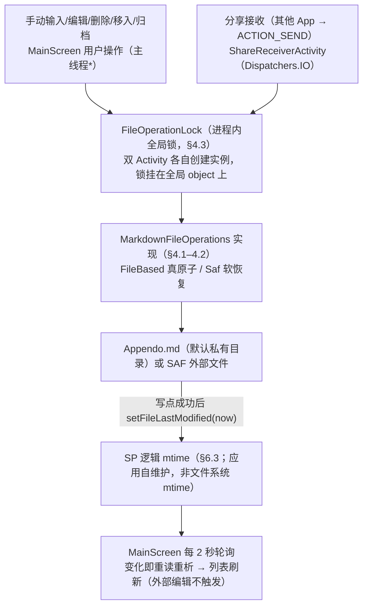

# Appendo 架构文档

> **本文定位（维护规则，任何修订须遵守）**：本文面向**人类程序员**，服务三个用途——
> 1. **学习**：理解系统现状与设计理由（"是什么、为什么"）；
> 2. **评审（review）**：作为代码评审依据——用 §3/§4 的不变量与 §11 的清单核对改动；
> 3. **验收**：作为功能验收依据——用 §12 的验收手段逐项验证。
>
> 因此本文是"现在的系统长什么样"的**唯一权威来源**，人与 AI 共用（AI 不另设架构文档）；内容须与代码一致，不一致时以代码为准并**回头修订本文**；只写"是什么、为什么"，不写过程史（历史见 [design.md](./design.md)、[design/](./design/)、[specs.md](./specs.md)）；结论可核验（引用 `文件#符号`，不引行号）。图表用 Mermaid 表达（GitHub/GitLab 原生渲染；VS Code 预览需较新版本或 Mermaid 插件）。

**编号图例**（正文引用的内部编号体系）：

| 编号 | 含义 | 定义处 |
|---|---|---|
| `TD-xxx` | 技术债编号 | [plans/debt-tracker.md](./plans/debt-tracker.md) |
| `K-x` | 代码级已知问题 | 本文 §8.1 |
| `specs NNN` | 需求/修订条款号 | [specs.md](./specs.md) 对应条目（正文引用处均附内容摘要） |
| `TC-xxx` | 测试用例编号 | [test-cases.md](./test-cases.md) |
| 批次案号（如 `N-4`、`F1`、`C-1`） | 某版本质量/修缮批次内的案例号 | 对应批次的设计/计划文档（正文随文标注） |

## 修订记录

| 日期 | 变更人 | 变更摘要 |
|------|--------|---------|
| 2026-08-31 | Yiyue + Claude | 初版（v1.2.0 源码逐文件核实的现状快照，收敛此前散落的架构知识）；三轮多角色评审修正事实错误；定位为学习/评审/验收三用途并新增 §11/§12；v1.2.1 技术债批次（TD-010~015）落地同步 |
| 2026-09-01 | Yiyue + Claude | 四项产品决策落地（§9 ADR：输入不 trim／allowBackup 拥抱云备份／旧数据首启一次性迁移／贪睡漂移取舍） |
| 2026-09-02 | Yiyue + Claude | v1.2.2 收尾：K10~K13 修复与真机验收同步（含 TD-021 SAF 授权失效自愈）；TD-022 决策维持现状 |
| 2026-09-17 | Yiyue + Claude | v1.3 主题功能（需求 48~56）同步：`ui/theme`、`theme_mode` 键；浅色对比度取舍登记 TD-023 |
| 2026-11-06 | Claude | v1.4「移入主题＋主题 IA 分家＋归档清空合并」同步：§1.2/§2/§3.3/§3.5/§3.6/§4.2/§6 与 §11 SP 键清单 |
| 2026-11-23 | Claude | v1.6.1 质量批同步：新增 §6.4 UI 状态保全；§7 补三测试类（JVM 用例 246→270）；细节权威＝workspace-completion-design.md 与 td-051-state-hoisting-design.md |
| 2026-11-24 | Claude | 面向人类程序员的可读性修订：内部编号引用自足化（specs/批次条款号降为括号附注）；§1.1 分层图重绘（清提醒组件残留）、§1.2 增导航路由图、§3.5 增事务时序图并修正事务通用化现状（六分类）、§6.1 增写入刷新数据流图；§2 模块地图补 MoveFlow/EntrySaveOps/StateSavers/SafeFocus/RefreshGuard；修正 ArchiveOutcome/archiveActionFor 迁址（MainScreen→ArchiveFlow，§2/§4.2）与 §8.1 K3/K4/K5/K9 过期状态；清理 v1.5.0 提醒退役残留（§3.3/§8.3/§9/§11/§12）；修订记录压缩 |
| 2026-11-24 | Claude ＋ 三方评审 | 三方评审修复批（新工程师/架构师/资深工程师并行，用户拍板范围）：§2 拆一行一文件＋视觉裁定入 §9 ADR＋版本注记只留共存形态；接口枚举改指向源文件（补 appendReturningTimestamp/deleteEntries/existsCheckDefinitive）；头部编号图例；§3.1 拆条、§3.3 两不变量精确化、§3.5 补归档创建入口/复制语义/兜底；§4.2 写读路径分组＋退化分支限定、§4.4 去退役语境；§6.2 墓碑升标题级、§6.3 补工作区移出写点、§6.4 Saver 计数修正（六枚）；§10 补三行路由、§11 补两组盲区、§12 补三验收行＋状态列瘦身；维护约定两级化；文末立包级 CLAUDE.md 分工规则（系统级现状只在本文维护） |
| 2026-11-25 | Claude | 图表专业化（用户要求）：§1.1 分层图/§1.2 导航路由/§3.5 事务时序/§6.1 写入刷新四张 ASCII 图改 Mermaid（flowchart/sequenceDiagram，语义不变）；头部维护规则加图表渲染说明；design.md 与 design/ 的 ASCII 图属历史归档不动 |

---

## 1. 系统概览

appendo 是一个极简 Android 速记应用：通过系统分享或手动输入收集文字，全部追加到一个 Markdown 文件里；支持条目编辑/删除、归档、主题工作区、添加到日历（v1.5.0 起应用内提醒退役，日历承接）。

核心设计判断：**Markdown 文件是唯一数据源（source of truth）**。没有数据库、没有 ORM——条目即文件里的文本块，时间戳标题行既是边界也是主键。整个系统的复杂度都源于把"一个人类可读的文本文件"当数据库用时必须回答的问题：

- 用户内容可能长得像条目边界 → 用零宽空格隔离（§3.3）
- 两个 Activity 会并发写 → 全局锁 + 原子写（§4）
- 文件可能被系统杀进程写到一半 → 原子写/软恢复（§4.2）

### 1.1 分层与依赖方向



依赖规则（实际代码遵循）：

- **util 不依赖 ui / data**（`EntryParser`、`CalendarEntryMapper`、`DuplicateHintThrottle` 全是纯函数/纯数据；`FileBasedMarkdownFile`、`SafMarkdownFile` 仅依赖 `android.content` 与 `androidx.documentfile` 做 I/O）。
- ui / data → util 单向依赖。util 内部被共享的除 `EntryParser` 外，还有 `MarkdownFormatter` 常量。
- `ui.MainScreen` 直接创建 `MarkdownFileOperations` 实例做读写——**没有 ViewModel、没有 Repository 中间层**。这是刻意保留的简单性（也是已知债务，见 §8 与 debt-tracker TD-008）。

### 1.2 双 Activity

| Activity | 职责 | 要点 |
|---|---|---|
| `MainActivity` | Compose 导航宿主（路由图见下） | — |
| `ShareReceiverActivity` | 接收 `ACTION_SEND`（text/plain），IO 协程里写入后 Toast + `finish()` | `noHistory` + `excludeFromRecents` + 空 taskAffinity，用户无感 |

导航路由（`MainActivity#AppendoNavHost`；带参数路由：`topic_workspace/{filePath}`、`archive_detail/{filePath}`，路径经 `Uri.encode` 传递）：



（`archive_detail` 的 kind 路由参数保留但恒缺省＝归档——主题详情路径已随 v1.5 工作区承接而退役。）

两 Activity 同进程（manifest 无 `android:process`），这是 `FileOperationLock` 进程内锁有效的前提。

为什么是两个 Activity：分享接收是独立、无需 UI 的动作——独立 Activity 不干扰主界面导航栈，`noHistory` 用完即弃；且它不经 Compose 直接写文件，是刻意保留的简洁快路径。

## 2. 模块地图

每文件一行的导航地图（职责一句话；细节以文件头 KDoc 与对应小节为准）。新增文件＝在此加一行。

**根包（入口）**

| 文件 | 职责 |
|---|---|
| `MainActivity.kt` | Compose 导航宿主（路由图见 §1.2）；持有主题三态 State、冷启动窗口主题 |
| `ShareReceiverActivity.kt` | 分享接收写入（`ACTION_SEND`，IO 协程）——无 Application 子类（通知渠道随提醒子系统退役删除） |

**`util/`（条目与文件协议层——纯逻辑核心，多数可纯 JVM 单测）**

| 文件 | 职责 |
|---|---|
| `EntryParser.kt` | **条目知识唯一收敛点**：parse/format/边界/时间戳单调/隔离标记/恢复判定/出口格式化 `formatForExport`/计数/批量删除行算法 `buildContentWithoutEntries`——纯函数，写读两侧与 `parse` 共享扫描（§3） |
| `MarkdownFileOperations.kt` | 文件操作接口＋全局锁 `FileOperationLock`；接口成员以本文件为准（§4.1/§4.3） |
| `MarkdownFileFactory.kt` | 按存储模式创建实现（§4.1） |
| `FileBasedMarkdownFile.kt` | 默认模式实现：真原子写 temp+fsync+rename（§4.2） |
| `SafMarkdownFile.kt` | SAF 模式实现：`.pending`/`.bak` 软恢复（§4.2） |
| `MarkdownFormatter.kt` | 仅文件级常量：文件头/归档文件名格式/分隔形态 |
| `ParsedEntry.kt` / `ReadResult.kt` | 解析条目／读结果（含 `failed` 标志，§4.4） |
| `EntryKey.kt` | `timestamp\|content` 条目唯一标识：寻址/去重/勾选三处共用 |
| `RefreshGuard.kt` | 列表刷新守卫纯函数：读失败/疑似异常跳过、header-only 合法空放行（§4.4） |
| `TopicMoveTransaction.kt` | 移入/移出/转移组合事务：单次持锁先写目标后删源，`MoveResult` 六分类（§3.5 时序图） |
| `CalendarEntryMapper.kt` / `CalendarLauncher.kt` | 添加到日历：标题映射纯函数＋`ACTION_INSERT` 单向预填（零日历权限） |
| `DuplicateHintThrottle.kt` | 重复内容提示：追加内容与已有条目相同时 Toast 报数；手动输入路径 5 秒节流，分享路径每次报数 |

**`data/`（存储偏好与归档/主题管理）**

| 文件 | 职责 |
|---|---|
| `FileRepository.kt` | SP 偏好＋URI 权限＋逻辑 mtime（§6.3）；归档文件名生成（两形态＋`_n` 同秒防覆盖，§3.5） |
| `ArchiveRepository.kt` | 归档增删查＋`archiveFileFor` 尾部锚定解析单点（§3.5） |
| `TopicRepository.kt` | `topics/` 主题文档管理＋`appendo_topics` 元数据＋首次指路旗标＋`renameTopic`（锁内三步、createdAt 保留、失败回滚） |
| `ThemePreferences.kt` | 外观三态偏好（一律 `commit()` 落盘）＋冷启动窗口主题 |

**`ui/`（Compose 界面）**

| 文件 | 职责 |
|---|---|
| `MainScreen.kt` | 主界面＋全部对话框：多选与移入、归档二选一、外观三选、首启引导、2 秒轮询刷新（§6.3） |
| `EntryListScreen.kt` | 可复用条目列表：滑动删除/长按复制/点击编辑/多选勾选；`headerSlot` 头部槽（四宿主共用：主列表/归档详情/主题详情/工作区） |
| `TopicWorkspaceScreen.kt` | 主题工作区：编辑/删除/批量/新增/复制/分享/归档，与主界面同权（`topic_workspace/{filePath}` 路由）；标题行＋防闪计数 |
| `TopicListScreen.kt` | 主题独立页：卡片/页内新建/空主题删除/恢复 |
| `ArchiveListScreen.kt` | 归档管理：仅整文件归档（主题入口在 `TopicListScreen`）；`ArchiveEntryKind` 枚举在此 |
| `ArchiveDetailScreen.kt` | 归档详情只读页（kind 路由参数保留但主题路径已退役，§1.2） |
| `EntryInputDialog.kt` / `EntryEditDialog.kt` | 无状态共享对话框（草稿提升宿主、onSave 单源、日历时序归宿主） |
| `EntrySaveOps.kt` | 共享写盘/出口小件：`tryEditSave`/`tryAppend`/`copyToClipboard`/`validationToast`——两宿主样板单源 |
| `MoveFlow.kt` | 移入/移出/转移三动词共享状态机：`MoveFlowHolder`＋`MoveOutcomeMapping` 决策映射＋`MoveRestoreDecision` 恢复重推导（§6.4） |
| `ArchiveFlow.kt` | 归档共享编排：sealed `ArchiveOutcome` 三分类＋决策映射 `archiveActionFor`＋`runArchive`＋词族＋二选一框——主界面/工作区两消费方 |
| `TopicMoveDialogs.kt` | 移入流程对话框：目标选择/新建命名/同名确认/失败重试/多选预览 |
| `ArchiveRestore.kt` | 恢复确认＋去重追加循环（归档/主题两路共用） |
| `MultiSelect.kt` | 多选选中集 `retainedSelection` 纯函数＋contextual 顶栏 |
| `SwipeCard.kt` | 滑动手势骨架：右删/左恢复/禁删钳 0；`ArchiveCard`/`TopicCard` 薄包装；振动反馈 internal 共享 |
| `TopicBadge.kt` | 主题首字标色板派生纯函数（对比度 ≥4.5:1，测试以 WCAG 公式独立复算） |
| `StateSavers.kt` | 状态保全 Saver 五枚（§6.4）——纯核心禁 import android.* |
| `SafeFocus.kt` | 恢复开态自动聚焦防崩：`requestFocusSafe()`（等一帧＋runCatching） |
| `Microcopy.kt` | 微文案常量源 |
| `LinkEntry.kt` | UI 条目模型（完整时间戳串作 key＋`timestampDisplay`） |
| `ToastUtils.kt` | 反色药丸 Toast（随应用主题反转），兼容旧版 Android |

**`ui/theme/`**

| 文件 | 职责 |
|---|---|
| `Theme.kt` | `ThemeMode` 三态（跟随系统/浅色/深色）＋双 ColorScheme（AA ≥4.5:1）＋success 扩展色＋状态栏同步；全 UI 经 `MaterialTheme.colorScheme` 取色（平面卡视觉裁定见 §9 ADR，色值表见 theme/CLAUDE.md）；XML 侧只管冷启动窗口背景/状态栏 |

**`EntryParser` 的地位**：所有"什么是一条条目"的知识（判定/解析/格式化/边界/时间戳单调/隔离标记/SAF 恢复判定）都收敛在这一个 object 里，纯函数。写侧（`format`）和读侧（`parse`）对称，两个存储实现共享同一套算法——v1.1 之前这套逻辑在两个实现里各复制一份，曾因此产生行为分叉。

## 3. 数据协议

这是本项目最重要的部分。改任何一条都可能破坏既有用户数据，先读这里再动 `EntryParser`。

### 3.1 Markdown 条目格式

文件头 + 条目块。一条条目由 `EntryParser.format` 写成：

```markdown
# Appendo

---

## 2026-08-12 14:30:00.123

用户内容（原样保留）

---

## 2026-08-12 15:00:01.456

另一条

---
```

（与 `EntryParser.format` 的确切输出逐字符一致：`\n---\n\n## {ts}\n\n{content}\n\n---\n`）

- 编码 UTF-8 无 BOM；内容**原样写入**（换行、缩进、符号不处理），唯一的**写侧**例外是 §3.3 的隔离标记。
- 条目边界 = **时间戳标题行**（不是 `---`，因为用户内容可能包含 `---`）。`---` 只是视觉分隔；删除条目时若前面紧跟 `---` 会连带删掉。
- **读侧隔离（编辑不再丢行）**：内容中恰为 `---` 或以 `# Appendo` 开头的行，写入侧与时间戳行同样加 ZWSP 隔离、读侧还原。
- **旧数据一次性迁移**：首启经 `EntryParser.migrateLegacyIsolation`（2026-09-01 决策③）补隔离——覆盖"被内容夹住的 `---` 行"与"文件头之外的 `# Appendo` 行"。残余不可恢复边界（保守规则宁漏勿误）：已被旧格式当作边界拆分的**时间戳形态**内容行、条目末尾紧贴收尾分隔线的 `---`。
- **trim 双侧政策**：`parse` 对整段内容 `trim()`——解析侧 trim 保留（模板空行与用户首尾空白不可区分，显示层去除首尾空白行）；**输入侧不 trim**（2026-09-01 决策①，分享内容首尾空白原样写入文件）；空内容条目不保留。
- 历史文件（v1.0.x）的时间戳是秒级，新文件是毫秒级，两者混存合法（§3.2）。

### 3.2 时间戳

| 属性 | 值 | 说明 |
|---|---|---|
| 写入格式 | `yyyy-MM-dd HH:mm:ss.SSS`（Locale.US，系统默认时区，java.time） | 自 **1.0.2** 起新条目毫秒级（1.0.x 为秒级；specs 修订记录称该批次为"v1.1"系设计阶段代号，实际发布版本 1.0.2） |
| 解析正则（宽松） | `^## \d{4}-\d{2}-\d{2} \d{2}:\d{2}:\d{2}(\.\d{1,3})?$` | 同时匹配秒级旧条目与 0–3 位毫秒，**所有**解析/计数必须用它 |
| 角色 | 条目主键 | 删除/更新/去重都用完整时间戳串；**LazyColumn key 是 `"${timestamp}_$index"` 复合键**（原因见下"重复时间戳"） |
| 单调防碰撞 | `EntryParser.nextTimestamp`：反向扫描最后一条时间戳，新值 = `max(now, last+1ms)` | 同毫秒连续追加不重号；仅约束 `append()`（now 路径），`appendEntry` 允许插入旧时间戳（归档恢复） |
| UI 显示 | `EntryParser.displayTimestamp` 剥掉毫秒段 | 用户永远看不到 `.SSS` |

字符串降序 == 时间降序（零填充 ISO 风格），所以列表排序直接 `sortedByDescending { timestamp }`，恢复的旧条目自动回到历史位置。

**重复时间戳是真实存在的**：`appendEntry` 不查碰撞——归档恢复按 `timestamp|content` 去重，**同时间戳不同内容**的条目（典型：归档后编辑过该条再恢复）会被同时追加；v1.0.x 秒级旧数据同秒两条也可能重复。后果：

- `EntryParser.findEntryBounds` 的语义是**命中第一条**匹配——删除/更新重复时间戳条目时，操作的是第一条，不一定是用户点的那条；
- LazyColumn 用复合 key 正是为了容忍它。严格唯一性只由 `append()`（now 路径）的单调时间戳保证。

### 3.3 内容隔离（ZWSP）与出口剥离——两条不变量

**问题**：用户收集的内容里可能有一行恰好是 `## 2026-01-01 10:00:00`，会被解析器误判成条目边界，导致条目被"劈开"。

**方案**：零宽空格 U+200B（`EntryParser.ISOLATION_MARKER`）。

> **不变量 1（写入隔离）**：任何写入路径（`format`/`buildUpdatedLines`）都会对"去掉前导 ZWSP 后命中**三类隔离形态之一**（时间戳行／恰为 `---`／`# Appendo` 开头——共用 `EntryParser.isSkippableLine` 谓词）"的内容行加一个 ZWSP 前缀；已带前缀则不加（幂等，防 read-modify-write 重复叠加）。
>
> **不变量 2（出口剥离）**：任何"内容离开本应用"的出口（复制、分享、日历预填）必须剥离标记——统一走 `EntryParser.stripIsolationMarkers`。剥离规则两情形：
> ① 行去掉全部前导 ZWSP 后是三类隔离形态之一 → 整行采用剥后版本（边界形态行前的多个前导 ZWSP 被整体剥除）；
> ② 否则原样返回（用户自打的 ZWSP 保留）。
>
> 读侧 `parse` 收集内容时用同一函数（`restoreLine`）还原。

当前出口清单（新增出口时必须加进这张表）：

| 出口 | 剥离方式 |
|---|---|
| 复制全部 / 分享全部（`MainScreen`） | **v1.3 起经 `parse` 产物 + `EntryParser.formatForExport` 格式化纯文本**（秒级时间戳行+内容，无结构标记——接收端智能解析丢内容问题，specs 68；`readAllForExternal` 原文路径停用） |
| 添加到日历（`CalendarEntryMapper.map`） | 显式 `stripIsolationMarkers` |
| 归档列表长按复制归档（`ArchiveListScreen`） | **v1.3 起同上：`parse` + `formatForExport`**（全文复制出口统一格式） |
| **主题页长按复制主题全文**（`TopicListScreen`，v1.4） | **同上：`parse` + `formatForExport`**（与归档长按复制同款——主题内容出口统一格式，出口铁律同 §3.3 两条不变量） |
| **长按复制单条**（主列表 / 归档与主题详情页 / 多选预览「复制」） | **经 `parse` 产物天然干净**——`parse` 收集内容时已用 `restoreLine` 还原（与 `stripIsolationMarkers` 内部同一函数），无需再剥 |
| 打开文件（`MainScreen#openFile` → 外部查看器） | **有意不剥离**（原文含 ZWSP 直出）——外部编辑器/查看器场景按已知约束不受支持（§8.2）；新增出口勿仿效，除非同样声明为不支持场景 |

**内部读取用 `readAll()`（保留标记）**，不要拿 `readAllForExternal` 的结果去做解析。

**隔离形态清单（v1.2.1 起，TD-015）**：时间戳行、恰为 `---`、以 `# Appendo` 开头，共三类；**隔离谓词与解析跳过谓词共用 `EntryParser.isSkippableLine`，不可分叉**（这是 TD-015 的根因修复原则）。旧条目经首启一次性迁移补隔离（§3.1，残余边界见该节）。

已知边界：历史归档（v1.1 之前创建）无 ZWSP 保护；外部编辑器直编 `Appendo.md` 不受支持（复制/分享是内容离开应用的主路径，为其保真；README 已声明）。

### 3.4 提醒 sidecar（已退役）

> **v1.5.0 整节退役（specs 16.C，2026-11-16）**：自建提醒子系统（sidecar SP `appendo_reminders`、闹钟调度、通知、开机补发、对账、深链）整体移除；提醒诉求由系统日历承接（`CalendarLauncher` ACTION_INSERT 单向预填）。存量 sidecar 升级后静默作废（文件残留无害，卸载随清）。历史设计＝tag `archive/self-built-reminders-final`。

### 3.5 归档文件与主题文档

**归档文件**：

- 命名两形态（并存于盘上，按前缀区分）：主界面归档 `Appendo_<yyyyMMdd_HHmmss>[_n].md`；主题归档 `Appendo_<主题名>_<yyyyMMdd_HHmmss>[_n].md`。同秒冲突以 `_n` 递增后缀规避（`FileRepository.getArchiveFile` 上限 100，满则返 null＝归档失败不覆盖）；存应用私有外部目录 `getExternalFilesDir`（即使当前活动文件是 SAF 模式；外部目录不可得时兜底内部 `filesDir`，与 topics 同款）。
- 识别与解析：同目录下文件名以 `Appendo_` 开头、`.md` 结尾（`ArchiveRepository.listArchiveFiles`）；时间戳/来源解析收敛 `archiveFileFor` 单点——尾部锚定正则（主题名可含下划线/纯数字，只能从尾部匹配时间戳；旧式先试，两式皆支持 `_n`），新式名产出 `ArchiveFile.sourceTopic`。
- 创建：走 `FileBasedMarkdownFile.writeAll`（享原子写+锁，与活动文件同格式，含 ZWSP）。入口＝主界面网格「归档」二选一（「归档并清空」／「只归档，保留列表」，产主界面归档名）；**主题工作区同一「归档」动作产主题归档**（`Appendo_<主题名>_<ts>…` 入名）——编排共享于 `ui/ArchiveFlow`，两消费方仅词族与善后不同。
- 恢复（归档管理页左滑）：解析归档与当前文件，按 `timestamp|content` 组合键去重，对新增条目 `appendEntry(原时间戳, 内容)`——保留原时间是去重真正生效的前提。**复制语义**：归档文件原条目保留（与主题恢复同）。

**主题文档**（v1.4「移入主题」，`topics/` 子目录）——与归档同级的第二种衍生文档：

- 存储位置：`getExternalFilesDir/topics/<用户命名>.md`，**与主文件存储模式无关**（SAF 主文件时主题仍在私有目录）；正向标识＝`topics/` 目录成员关系（非命名排除式判据）。`topicsDir()` 对 `getExternalFilesDir` 为 null 的兜底与双候选目录合并扫描自愈见 `TopicRepository`。
- 文件格式：**完全沿用 §3.1 协议**（`# Appendo` 文件头＋同一条目模板＋ZWSP 隔离不变量）——`parse`/`formatForExport` 直接可用；移入条目**原时间戳原样**、按时间戳字符串升序追加到目标末尾。
- 创建时间元数据：SP `appendo_topics` 的 `created_<文件名含.md>`（epoch millis，一律 `commit()`）；key 丢失时首见以 `file.lastModified()` 回写一次后冻结；移入只改文件不动 SP——列表排序＝createdAt 倒序，稳定不漂移；条数不入 SP，加载时实时 `EntryParser.countEntries`。
- 命名规则（`TopicNameRules` 纯函数，校验顺序固定）：空名 → 保留字（`Appendo` 全等/`Appendo_` 前缀，大小写不敏感）→ 非法字符（`/ \ : * ? " < > |` ∪ C0 控制）→ 长度 ≤50 → 同名（displayName 大小写不敏感比对，阻止并确认）。
- 删除：仅空主题（0 条）可删（先删文件成功后删 SP key）；非空主题右滑钳 0 零响应。
- **移入/移出/转移组合事务**（`util/TopicMoveTransaction`；v1.4 为移入单向，v1.6 通用化三动词——移入＝主→主题、移出＝主题→主、转移＝主题A→主题B，源/目标均可为 FileBased 或 SAF）：单次持 `FileOperationLock` 先写目标后删源（`deleteEntries` 按 `EntryKey` 寻址、行算法与 `parse` 共享扫描）；`MoveResult` 六分类（`Success`/`SameDocument` 防御护栏/`SourceReadFailed`/`TargetReadFailed`/`TargetWriteFailed`/`SourceDeleteFailed`），任一失败态不出现"两边都没有"，重试幂等收敛；源读失败＝干净失败零副作用。六步编排时序：


- 恢复：复用归档恢复交互（`ui/ArchiveRestore`），复制语义（主题文档保留原条目）。
- 指路旗标：`TopicRepository.consumeFirstMoveGuide()`——首次有效移入（moved>0 成功）toast 附指路后缀，读后置位一次完成（§3.6 键清单）；数据层仅此一个与协议无关的旗标方法。

### 3.6 SharedPreferences 清单

| 文件 | 键 | 用途 |
|---|---|---|
| `appendo` | `use_saf` / `file_uri` / `file_last_modified` / `theme_mode` | 存储模式、SAF URI、**逻辑 mtime**（§6.3）、主题三态（v1.3，缺省=system 不写入） |
| `appendo_topics`（v1.4） | `created_<文件名含.md>` / `first_move_guide_shown` | 主题创建时间元数据（§3.5；元数据一律同步 `commit()` 落盘——TD-024：realme 实测 `apply()` 异步落盘可长时间不落盘、进程死即丢）＋首次移入指路旗标（`TopicRepository.consumeFirstMoveGuide`，纯 UI 引导元数据） |

> `appendo` 这个名字是历史沿革（更早叫 `link_appending`）；老设计文档里写的 `link_appending` 已过时。

## 4. 存储双模式与完整性

### 4.1 双模式

| | 默认模式 | SAF 模式 |
|---|---|---|
| 实现 | `FileBasedMarkdownFile` | `SafMarkdownFile` |
| 位置 | `getExternalFilesDir/Appendo.md` | 用户经 SAF 选择的外部文件（URI） |
| 进入方式 | 首次启动默认 / URI 失效自动回退 | 首启引导对话框或菜单"自定义目录" |
| 原子性 | **真原子**（temp+fsync+rename） | **软恢复**（.pending/.bak） |

构造：`MainScreen` 经 `MarkdownFileFactory.create(context, useSAF, fileUri, defaultFile)`；**`ShareReceiverActivity` 因需先做 URI 有效性判定而直接实例化两个实现类——改工厂签名/新增存储模式时必须同步检查这里**。接口成员**以 `util/MarkdownFileOperations.kt` 为准**（勿依本文散文清单），其中三个易漏：`appendReturningTimestamp`（追加并返回实际写入时间戳——「先落盘再跳日历」时序用）、`deleteEntries`（按 `EntryKey` 批量删除，失败返 null ⟺ 操作未发生）、`existsCheckDefinitive`（exists() 判定是否权威——§3.5 事务读目标分派的判据）。`readAllForExternal` 默认方法保留但已无调用方。两实现算法同源（都调 `EntryParser`），差异只在 I/O 原语。

SAF 模式回退：由两个入口各自检查 `isFileUriValid()`，失效即 `clearFileUri()`（先清偏好再释放权限，防中途崩溃永久丢 URI）后回默认文件——`MainScreen` 在启动 `LaunchedEffect` 里检查一次，`ShareReceiverActivity` 每次写入前检查。（`SafMarkdownFile.exists()` 捕获 SecurityException 只记日志返回 false，不单独触发回退。）首启时 `isFirstLaunch()` 为真会弹引导对话框建议把文件放外部存储（重装不丢数据）。

**SAF 授权失效自愈（v1.2.2，TD-021）**：实测（realme）`takePersistableUriPermission` 未能持久化 + 覆盖安装会清除授权，而 `isFileUriValid()` 此时常仍返回 true——`MainScreen.refreshEntryCount` 检测到"SAF 模式 + 读失败"时弹「数据文件访问已失效」对话框（[重选文件] 复用 `changeFileLauncher` / [回退默认] `clearFileUri`），不再静默空列表；`ShareReceiverActivity` 在 SAF 写失败时 Toast 明示"授权可能已失效，请打开 appendo 重选"，自动回退默认时提示"已保存到默认文件"（防数据无声分家）。

### 4.2 原子写语义

**默认模式（真原子）** `FileBasedMarkdownFile.atomicWrite`：
同目录临时文件（避免跨文件系统 rename EXDEV）→ `fd.sync()` → `renameTo`，rename 失败退化为直接覆写；写前清理上次崩溃残留的孤儿 tmp。rename 路径下任何时刻崩溃，文件要么是旧内容要么是新内容（覆写退化分支除外——该分支覆写中崩溃可能半写，罕见）。

**SAF 模式（软恢复）** `SafMarkdownFile.safAtomicWrite`：SAF 无原子重命名能力，承诺降级为——

**写路径**（持锁）：
1. 写前：当前内容备份到 `.bak` + 建 `.pending` 标记（均存应用私有目录，文件名按 URI 哈希派生，切换文件时清理防串档）
2. 写主 URI（`openFileDescriptor("wt")`，fsync 尽力而为、不依赖）
3. 成功删 `.pending`

**读路径**（读本身可能触发恢复）：读前 `ensureConsistent()`（持锁）：`.pending` 残留 = 上次写未确认 → 用 `.bak` 覆写主文件，`readAllWithStatus` 返回 `recovered=true`（UI Toast 透明提示）；无 `.bak` 可恢复时仅删 `.pending`、不提示。

> 语义：崩溃后回滚到上次良好状态。**最近一次未完成的写入可能丢失，但文件不会损坏。**（README 已声明）
>
> ⚠️ 曾有两个现实缺口（K8，**v1.2.1 已修复其一**）：写路径原先直读主文件、不先恢复，且把可能脏的内容写进 `.bak`（崩溃后若下一个操作是写入，脏状态被固化、好备份被污染）——现已改为写路径统一走 `readMainForWrite`（先 `ensureConsistent` 再读）。保留现状：恢复动作本身失败时删 `.pending` 防反复尝试，既未恢复也无提示（罕见退化分支）。

`clear()` 两种模式都**不走** .bak——直接写文件头。数据安全由"清空前自动归档"兜底（specs：清空必先备份；v1.4 起该路径＝网格「归档」二选一的「归档并清空」），避免崩溃回滚把清空前的内容又还回来。两个如实记录的边界：**归档失败绝不清空**（TD-017：v1.2.2 设防——归档失败阻止清空；v1.4 重构为 `archiveFile → sealed ArchiveOutcome`（`Archived(file)`/`NothingToArchive`/`Failed` 三分类；v1.6 起定义于 `ui/ArchiveFlow.kt`），决策映射纯函数 `archiveActionFor(outcome, path, name, wordbook)` 按「归档并清空／只归档」两路径给出 toast 字面与是否 clear——`Failed` 不清空并提示「归档失败，未清空」，清空段失败提示「清空失败（归档已保存）」，空内容分支 `NothingToArchive` 不清空；写盘段与重构前逐字节等价，决策映射由 `ArchiveOutcomeMappingTest` 全组合钉死（穷举单测固定行为防回归））；`clear()` 本身不消费残留 `.pending`——若 clear 与上次崩溃残留之间无任何读操作，下次读会用 `.bak` 回滚掉清空（当前 UI 流程启动必先读、实际不可达，记为已知时序边界）。

### 4.3 并发：FileOperationLock

`MarkdownFileOperations.kt` 里的全局 `object`。**接口全部成员**（含 `deleteEntries` 等后增成员，及 SAF 的 `ensureConsistent`）都 `synchronized(FileOperationLock)`——核对时以接口文件为准，勿依任何枚举清单。

- 为什么是全局对象而不是实例锁：`MainScreen` 与 `ShareReceiverActivity` 各自 new 实例，实例锁挡不住跨实例并发。
- 为什么读也要持锁：SAF 读前要做恢复判定（读本身有写副作用）；且 read-modify-write 语义要求读到的不是半写状态。

### 4.4 错误处理契约（读失败 = 空串的防线，K7）

两个实现的 `readAll()` 在读失败时仍返回**空串**（兼容既有调用方），但 v1.2.1 起 `ReadResult` 增设 `failed` 标志，且破坏链已全部加守卫：

1. ~~`initHeader` 把空串当空文件 → 覆写已有文件~~ → **已守卫**：读失败返回 false，不写；
2. ~~`append` 见空 → 全量重写为 header+新条目~~ → **已守卫**：读失败中止返回 false（`appendEntry`/SAF 的 `writeAll`/`deleteEntry`/`updateEntry` 同）；
3. ~~把"解析得 0 条"当真空 → 误清数据~~ → **已守卫**：`MainScreen.refreshEntryCount` 经 `RefreshGuard` 纯函数判定——读失败或"内容空白且解析为空且上轮非空"跳过；header-only 是合法空文件放行。（该守卫最早为已退役的提醒对账而设，现保护的是列表刷新：曾因"空且上轮非空"一刀切产生删至 0 条 UI 滞留回归，K10/TD-016，修复并有 `RefreshGuardTest` 固定。）

**纪律**：任何"读结果为空"的分支都应先怀疑读失败，而非真空文件；新增读侧消费方优先用 `readAllWithStatus` 的 `failed` 判断。

## 5. 提醒子系统（已退役）

> **v1.5.0 整章退役（specs 16.C，2026-11-16）**：自建提醒子系统整体移除（组件/状态机/开机恢复/对账/自检/深链各节随之作废，历史内容见修订记录或 tag `archive/self-built-reminders-final`）。提醒诉求由系统日历承接：`CalendarLauncher`（ACTION_INSERT 单向预填，零日历权限）＋`CalendarEntryMapper`（标题映射纯函数，出口经 stripIsolationMarkers）——入口在详情对话框与手动输入对话框主按钮区。

## 6. 并发与线程模型（现状）

### 6.1 线程

- `ShareReceiverActivity`：全部文件 I/O 在 `lifecycleScope + Dispatchers.IO`。
- `MainScreen.refreshEntryCount`：读文件+解析在 `Dispatchers.IO`。
- 仍在主线程同步 I/O 的用户操作：追加/删除/更新/复制/分享，以及**最重的归档恢复**（归档/主题恢复全文读取+解析+逐条 `appendEntry`，每条都是全文件原子写）——个人笔记体量下可容忍，属已知债务（TD-008，随 ViewModel 重构一并下放）。v1.4 起归档二选一两路径（`runArchiveAction`：归档段与清空段均在 `Dispatchers.IO`）与移入主题事务（`executeMove`）已下放 IO；主题页列表加载与操作后重载亦走 `Dispatchers.IO`。
- 归档列表加载、归档详情加载在 `withContext(Dispatchers.IO)`。
- 锁是 JVM 内置 `synchronized`，跨这些线程互斥有效。

写入与列表刷新全景（谁在写、怎么互斥、UI 怎么知道该刷新）：



* 主线程同步 I/O＝已知债务（TD-008，见上清单）；归档/移入两类重操作已在 IO 线程。

### 6.2 （已随提醒子系统退役，编号保留防既有引用漂移）

原 §6.2 提醒线程模型随 v1.5.0 子系统退役移除；历史内容见 §3.4/§5 墓碑与 tag `archive/self-built-reminders-final`。

### 6.3 列表刷新：2 秒轮询 + 逻辑 mtime

`MainScreen` 每 2 秒比对 `FileRepository.getFileLastModified()`——注意这是**存在 SP 里的逻辑时间戳**（应用每次写完调 `setFileLastModified(now)`），不是文件系统 mtime。效果：本应用各入口（分享接收、手动输入）的写入都会被轮询捕获；**外部编辑不会触发刷新**（与"不支持外部编辑"的立场一致）。该 mtime 由**各写点手工调用**维护（主列表写点在 `MainScreen`——手动输入/编辑/删除、移入事务成功与 `SourceDeleteFailed`（后者源可能已部分移除，立即主动刷新）；分享写入在 `ShareReceiverActivity`；恢复路径在 `ui/ArchiveRestore`，归档/主题两路共用各计一处；**工作区移出方向**在 `TopicWorkspaceScreen`——条目回主文件时补调）——**新增写入路径必须补调**，否则列表不刷新。v1.4 新写盘点口径：**主题文档（`topics/`）写入不触发主文件 mtime**（不同文件，主题页自身导航加载）；「归档并清空」清空成功后改调 `clearFileLastModified()`（清键驱动下轮轮询重读——文件已空、清键语义更准）＋`refreshEntryCount()`，「只归档」主文件未动不调。

### 6.4 UI 状态保全（v1.6.1，2026-11-20）

Activity 重建（uiMode 深浅切换等）与 SavedInstanceState 恢复路径上，**用户工作流状态经 `rememberSaveable` 保全**（此前 remember 级全丢——TD-051 债已偿）。设计权威＝`docs/design/td-051-state-hoisting-design.md`（定稿）。

- **分立式接线**：各字段原位 `remember` → `rememberSaveable`；自定义 Saver 共**六枚**：`ui/StateSavers.kt` 五枚（`EntryKeySetSaver` 选中集——排序确定性编码＋200KB 容量守卫**确定性截断**、`NullableStringSaver` 字符串编码原语、`LinkEntrySaver`／`TopicDocumentSaver` 目标身份、`MoveFlowHolderSaver` 快照/恢复工厂）＋`TopicListScreen.kt` 局部 `CreateStepSaver`（新建流程步骤）。StateSavers.kt **纯核心禁 import android.\***（`isReturnDefaultValues=true` 下 JVM 假绿围栏）。
- **保存面**（两宿主镜像＋主题页）：草稿三件套／多选态＋选中集／编辑与删除目标身份／用户工作流对话框旗标／moveFlow（含 `newTopicInput`）。**不保存**：重载可再得的数据态（entries/topics）、瞬态 UI（菜单/关于/外观框）、系统态对话框（首启引导/SAF 失效——检查逻辑重触发）、`scrollAfterAdd`。
- **红线**：草稿/多选/flow 的 `rememberSaveable` **既无 key 也无 inputs**（`rememberSaveable` 不带 key/inputs 时，代码位置或 inputs 任一变化即静默丢已保存状态——specs 106 修订⑤确立的纪律）。
- **executing 重推导**：move 事务全程在 `synchronized` 块内**零挂起点**——重建不能打断事务中段，事务跑完但结果被丢弃＝快照 `executing` 可能失真。恢复＝暂记 failed 呈重试面貌＋一次性标记，**首次重载成功后按选中集（经 retainedSelection 过滤）存空重推导**真实结局：空＝事务已完成→静默关流程；非空＝未发生或部分完成（「两边都有」的软中间态，specs 84(d)）→保持重试幂等收敛（`MoveRestoreDecision` 纯函数，JVM 钉死）。
- **恢复开态副作用防御**：恢复帧 LaunchedEffect 自动聚焦早于对话框窗口挂载会崩（真机实证，v1.6.1 验收用例 C-1）——所有自动聚焦走 `ui/SafeFocus.kt` 的 `requestFocusSafe()`（等一帧＋runCatching）。
- **工作区标题行（v1.6.1 修缮案 F1；specs 16.D 修订注一）**：主题名＋计数在顶栏下方全宽标题行（LazyColumn 首项，随列表滚动）；计数走独立 `titleCount` 状态**仅成功分支赋值**（重载不闪 0、读失败保留旧值）；多选 contextual bar 三长钮（「移出到主列表」「移入其他主题」「删除」——specs 96 定稿字面）挤压下主题上下文由标题行承载。
- 进程死亡：同一 SavedStateRegistry 机制覆盖（Saver round-trip JVM 钉死）；本机（RMX3560）真机配方不可达（am kill/kill -9/WRITE_SECURE_SETTINGS 均被 ROM 拒）——降级论证在案（test-cases TC-104）。

## 7. 测试策略

| 层 | 现状 | 说明 |
|---|---|---|
| 纯 JVM 单测 | ✅ 主体 | `EntryParserTest`、`CalendarEntryMapperTest`、`DuplicateHintThrottleTest`、`FileBasedMarkdownFileTest`（mock Context）、`FileRepositoryFirstLaunchTest`、`MarkdownParserTest`（parseMarkdownEntries 薄包装，K5 对应）、`ArchiveRestoreDeduplicationTest`、`EntryDeletionIntegrationTest`；v1.4~v1.6.1 增 `TopicMoveTransactionTest`、`TopicRepositoryTest`、`MoveOutcomeMappingTest`、`ArchiveOutcomeMappingTest`、`MultiSelectTest`、`SecondLevelEquivalenceTest` 等；**v1.6.1 增 `StateSaversTest`/`MoveFlowHolderRestoreTest`/`MoveRestoreDecisionTest`**（v1.6.1 质量批 N-4 案·状态保全纯核心——Saver round-trip/corruption 穷举/executing 重推导矩阵；270 基线） |
| Robolectric | ⚠️ 依赖已声明，当前环境跑不了（android-all jar 下载失败，TD-003） | FileBased 路径用 mock Context 纯 JVM 覆盖 |
| Instrumented | ⚠️ androidTest 依赖已备、用例未写（TD-006） | SAF 路径（真 ContentResolver、授权失效）目前靠真机手动验证 |

原则：**新增逻辑优先落纯函数**（util 的 `object`），让它在纯 JVM 可测——这是 `EntryParser` 存在的直接原因。

```bash
./gradlew testDebugUnitTest   # 单元测试
./gradlew assembleDebug       # 构建
```

## 8. 已知问题与约束

### 8.1 代码级已知问题（v1.2.1 批次后）

| # | 问题 | 状态 |
|---|---|---|
| K1 | `ArchiveRepository`/`MainActivity` 归档计数用严格秒级正则，新建归档显示"0 条" | ✅ 已修复（v1.2.1，TD-010）：改 `EntryParser.getTimestampRegex()` |
| K2 | `MarkdownFormatter.formatEntry` 死代码 + 误导注释 | ✅ 已删除（v1.2.1，TD-011），连同 `TIMESTAMP_FORMAT` 与严格正则 |
| K3 | `lifecycle-viewmodel-compose` 已声明未使用（无 ViewModel） | 保留（随 ViewModel 重构启用，与 TD-008 关联） |
| K4 | `AppendoApplication` 创建的 `write_feedback` 渠道无使用方 | ✅ 已消解（v1.5.0：Application 子类随提醒子系统退役删除） |
| K5 | `MainScreen.parseMarkdownEntries` 薄包装（TD-007）、主线程 I/O（TD-008） | 保留（随 ViewModel 重构一并处理，见 §6.1） |
| K6 | 解析层静默丢内容（`---`/`# Appendo` 行编辑后丢失） | ✅ 已修复（v1.2.1，TD-015）：隔离谓词与跳过谓词共用 `isSkippableLine`；旧条目不可回溯（限制已声明） |
| K7 | 读失败=空串三条破坏链（覆写/清库/误杀提醒） | ✅ 已关闭（v1.2.1，TD-012）：`ReadResult.failed` + 存储层守卫 + 对账守卫（§4.4） |
| K8 | SAF 写路径不先恢复、脏内容污染 `.bak` | ✅ 已修复（v1.2.1，TD-013）：写路径统一 `readMainForWrite` 先恢复（§4.2） |
| K9 | 应用更新后闹钟全丢直至重启 | ✅ 已修复（v1.2.1，TD-014）——该修复已随 v1.5.0 提醒退役一并移除（`MY_PACKAGE_REPLACED` Receiver 不复存在） |
| K10 | K7 对账守卫假阳性回归：删至 0 条后 UI 滞留已删条目 | ✅ 已修复（v1.2.2，TD-016）：守卫收敛 `RefreshGuard` 纯函数（header-only 合法空放行）；真机验收通过 |
| K11 | 清空前归档兜底不设防 | ✅ 已修复（v1.2.2，TD-017）：归档失败阻止清空并提示 |
| K12 | SAF 授权丢失（覆盖安装清授权；realme 实测 `takePersistableUriPermission` 未持久化）→ 静默空列表、分享数据"无声分家" | ✅ 已修复（v1.2.2，TD-021）：读失败+SAF 弹「数据文件访问已失效」对话框（重选/回退）；分享失效明示；真机活体验收 |
| K13 | 归档详情残留活动文件的提醒徽标（快照视图语义错位） | ✅ 已修复（v1.2.2，真机验收发现）：readOnly 视图不渲染徽标 |

其余技术债（CRLF 规范化、.bak 驻留、SAF PoC 结论待填等）见 [plans/debt-tracker.md](./plans/debt-tracker.md)。

### 8.2 对用户的约束声明（README 同步）

- 外部编辑器直编 `Appendo.md` 不支持（ZWSP 机制会被破坏；复制/分享出口已剥离标记）。
- SAF 模式为软恢复：崩溃丢最近一次写入、不损坏文件。
- 不建议降级安装（旧版读不了毫秒条目——数据仍在文件中，重装新版恢复显示；T-dgchk 已核实 v1.0.x 追加为纯 append 模式、不会重写文件）。
- 旧数据 `---`/`# Appendo` 行：v1.2.2 首启自动迁移修复（§3.1），残余边界极少数仍不可见。
- 重复时间戳（归档恢复+编辑组合场景）下删除/编辑作用于靠前的条目（§3.2）。
- 单次分享上限 10,000 字符（拒绝并提示，不截断）。
- 多设备/云盘同步不支持（外部编辑不触发刷新 + 锁仅进程内，§6.3）。
- 换机与备份：数据随 Android 系统云备份迁移（决策②，README「换机与备份」小节）。

### 8.3 安全与隐私事实

- **攻击面**：仅两个 Activity exported（`MainActivity` MAIN/LAUNCHER；`ShareReceiverActivity` ACTION_SEND text/plain）。（v1.5.0：提醒双 Receiver 与全部 PendingIntent 随子系统退役移除，不再有 receiver 组件。）
- 分享入口限长 10,000 字符（防 DoS）；超长被拒绝写入（不截断），Toast 明确提示『内容过长（上限 N 字符），未追加』（N=10000，v1.3.x 微文案统一）
- **hashCode 派生标识的碰撞面**（个人级概率极低，已知约束）：SAF 软恢复的 `.bak`/`.pending` 文件名按 URI 哈希派生，理论碰撞会导致恢复文件互串。（闹钟/通知 id 哈希派生已随 v1.5.0 提醒退役移除。）
- **`allowBackup="true"`——已决策（2026-09-01，决策②）**：保持开启、拥抱云备份。`Appendo.md`、`topics/` 主题文档与 SP 偏好随 Android 云备份迁移/恢复；理由：默认模式数据在应用私有目录、卸载即失，云备份对用户是净收益。对用户的口径："应用自身不联网、无第三方 SDK"（README「换机与备份」小节落地）。

## 9. 设计决策索引（ADR）

| 决策 | 结论 | 为什么（一句话） | 详见 |
|---|---|---|---|
| 数据存储 | 单 Markdown 文件为唯一数据源 | 用户可读可迁移，符合"速记"定位；代价是协议复杂度（本文 §3） | specs |
| 条目主键 | 完整时间戳串（毫秒） | 索引会漂移；单调防碰撞只在 append 路径保证唯一，重复时间戳真实存在（§3.2） | design.md v1.1 节 |
| 内容隔离 | ZWSP 前缀，出口统一剥离 | 零侵入且可逆；保"内容原样"承诺 | design.md v1.1 节 |
| 原子写 | 默认真原子 / SAF 软恢复 | SAF 无原子重命名，诚实降级优于假装原子 | design.md v1.1 节 |
| 并发 | 进程内全局锁 | 双 Activity 同进程，锁即足够；无跨进程需求 | — |
| 重复提醒语义（已随 v1.5.0 提醒退役，历史决策） | 开机错过只补发最新一次；"完成"保留系列 | 不刷屏；用户要的是"别丢下一次" | 历史 tag `archive/self-built-reminders-final` |
| 日历集成 | `ACTION_INSERT` 预填拉起（方案 A） | 零权限不上云；定位为次要入口 | design/local-reminder-design.md §3 |
| 平面卡视觉（v1.4 两轮裁定） | 浅 `#E8EDF4` 蓝调底＋`#FFFFFF` 纯白卡／深 `#000000` 底＋`#26252B` 卡；卡片零投影，层级靠底色差，条目间距 8dp | 换机验证反馈：投影在双模式都显脏，参考 iOS 分组列表；色值详表见 ui/theme/CLAUDE.md | ui/theme/CLAUDE.md |
| 架构形态 | 无 ViewModel/Repository 中间层 | 单屏小应用，YAGNI；债务记录在案 | §8、TD-008 |
| 内容保真边界（2026-09-01①） | 输入侧不 trim（首尾空白原样入文件）；解析侧 trim 保留（模板空行与用户首尾空白不可区分，显示层去除）；空内容条目不保留 | 可避免的丢失全消除，不可区分处以显示层语义披露 | §3.1 |
| 隐私与备份（2026-09-01②） | `allowBackup=true` 拥抱云备份 | 私有目录卸载即失，备份是净收益；口径"应用自身不联网" | §8.3 |
| 旧数据迁移（2026-09-01③） | 首启一次性补隔离（`migrateLegacyIsolation`，保守规则宁漏勿误） | 拆"旧条目编辑即丢行"的雷 | §3.1 |
| 贪睡语义（2026-09-01④；已随 v1.5.0 提醒退役） | 系列随贪睡漂移（重锚点） | 符合"我贪睡了，以后就这个点"的直觉 | 历史 tag `archive/self-built-reminders-final` |
| 重启锁屏期提醒（TD-022，2026-09-02；已随 v1.5.0 提醒退役） | 维持现状：解锁后重注册/补发（不丢只延迟） | DE 镜像方案成本中高 + OEM 送达不可控 + 双写新债，vs 低频场景已有兜底 | debt-tracker TD-022 |

## 10. 阅读地图

想改某类东西 → 先读哪：

| 想做什么 | 先读 | 再动 |
|---|---|---|
| 条目格式/解析/时间戳 | §3.1–3.2 | `EntryParser`（及 `EntryParserTest`） |
| 新增复制/分享类出口 | §3.3 不变量 2 | `stripIsolationMarkers` 接入点 |
| 存储后端行为 | §4 | `FileBasedMarkdownFile` / `SafMarkdownFile` |
| 页面/交互 | §1、`ui/` 各文件头注释 | `MainScreen`（状态在 Compose `remember`/`rememberSaveable` 里，无 ViewModel，§6.4） |
| 主题/移入/移出/转移 | §3.5 | `TopicMoveTransaction`＋`ui/MoveFlow` |
| 归档/恢复/清空 | §3.5＋§4.2 | `ArchiveRepository`＋`ui/ArchiveFlow`/`ui/ArchiveRestore` |
| 对话框/多选状态保全 | §6.4 | `ui/StateSavers`/`ui/SafeFocus` |
| 加新测试 | §7 | `src/test/` 对应包 |
| **review 一个改动** | §11 | 按改动面过评审清单 |
| **验收一个功能** | §12 | 单测 + 真机验证要点 |

## 11. 变更评审清单（review 用）

评审 PR / 自查时按改动面逐条核对。清单是下限不是上限——§3/§4 的不变量永远适用。

**动了数据协议（`EntryParser` / 条目格式 / 时间戳）**
- 宽松正则仍同时匹配秒级与毫秒级；写入仍固定 3 位毫秒
- 写侧隔离（不变量 1）与出口剥离（不变量 2）保持对称；新增出口已登记进 §3.3 出口表
- 单调性只约束 `append()` now 路径；`appendEntry` 仍允许插入旧时间戳
- 旧文件仍可解析：秒级条目、无 ZWSP 的历史归档、混合格式
- 批量删除/移入事务与 `parse` 共享扫描（`buildContentWithoutEntries` 消费同一行区间产物，无平行边界逻辑）；移入事务单次持锁先写后删（§3.5）
- 有纯 JVM 单测；`architecture.md` §3 已同步修订

**动了存储层（`FileBasedMarkdownFile` / `SafMarkdownFile` / 工厂）**
- 新增读写方法持 `FileOperationLock`
- 读失败没有被当成空文件处理（对照 §4.4 三条破坏链，不要新增第四条）
- SAF 写路径若变，核对 `ensureConsistent` 与 `.bak` 写入时序（TD-013）
- `ShareReceiverActivity` 直接实例化的路径是否受影响（§4.1）

**动了 UI / 内容出口**
- 新的内容出口走 `stripIsolationMarkers` 或经 `parse` 产物（§3.3 出口表）
- 新写入路径补调 `setFileLastModified`（§6.3），否则列表不刷新
- 新增耗时操作不落在主线程同步 I/O（对照 §6.1 清单，只减不增）
- 动了共享组件（`EntryListScreen`/`SwipeCard` 等）→ 逐宿主核对（主列表/归档详情/主题详情/工作区），readOnly 页语义是否仍成立
- UI 决策逻辑落纯函数并配 JVM 全组合测试；出口格式化改动扩 `ExportFormatTest`

**动了 manifest / 权限**
- exported 组件清单未意外扩大（当前仅双 Activity）；新增 receiver/组件须同步核对 §8.3 攻击面描述
- 新增权限有明确用途；`allowBackup` 若变动，须先推翻 §8.3 决策②（拥抱云备份）再动

**动了 SP 键（事实上的持久化协议）**
- SP 文件名与键（`appendo`、`appendo_topics`、`created_` 前缀与 `first_move_guide_shown`，§3.6）：改名即丢用户偏好/主题元数据

**任何改动（通用）**
- 按根 CLAUDE.md「任务完成检查」逐项过文档清单，**"改动面 → 本文回改小节"的映射显式过一遍**——§4.3/§8.3 曾因漏做此步而与代码脱节（四角色评审教训）

## 12. 验收手段（验收用）

> "状态"列如实记录最近一次执行情况；"未定向执行"≠ 通过。SAF 崩溃恢复当前**未覆盖**（与 debt-tracker 记录一致），对刚重构过的路径应安排定向验收而非日常观察。

| 验收对象 | 手段 | 状态 |
|---|---|---|
| 单元回归 | `./gradlew testDebugUnitTest` 全绿（改数据协议/存储层必跑） | ✅ 2026-11-23（v1.6.1 发布批 270 用例；最近全量实跑 2026-11-05，`--max-workers=1` 0 失败 0 跳过） |
| 构建 | `./gradlew assembleDebug` 成功 | ✅ 2026-08-31 |
| 默认模式数据完整性（真机） | 追加/删除/编辑后核对文件：debug 构建用 `adb shell run-as com.yiyue31.android.appendo cat /storage/emulated/0/Android/data/com.yiyue31.android.appendo/files/Appendo.md`（Android 11+ 文件管理器**无法**访问该目录，勿用"文件管理器查看"）；核对内容完整、无半写、无 BOM | ✅ 2026-08-31（写入+run-as 抽查） |
| SAF 模式（真机） | 切换外部文件 → 写入 → 读回一致。崩溃恢复需**在写入窗口内中断**才触发（"限制后台后杀进程"发生在后台化时、造不出窗口，勿用）；可在写入瞬间 `adb shell am crash com.yiyue31.android.appendo` 模拟 | 部分 ✅ 2026-09-02：授权丢失场景已活体复现并验证 TD-021 修复对话框；`am crash` 写入窗口崩溃恢复仍未做（TD-006 关联） |
| 删除最后一条（TD-016 修复后） | 删除唯一条目 → 列表立即清空、计数归 0、与"已删除"Toast 一致 | ✅ 2026-09-02（用户验证：删空立即归零） |
| 出口干净度 | 复制全部/复制单条/分享/日历预填 → 粘贴进**可检测 U+200B 的工具**（支持"显示不可见字符"的编辑器或在线 zero-width 检查器）比对无零宽字符 | ⛔ 未做字符级检查（视觉检查不充分） |
| 升级兼容 | 旧秒级数据装新版本条目可读、计数正确（默认模式需 adb 推送旧格式文件；SAF 模式可外部构造后选择） | ✅ 2026-08-31（1.2.0→1.2.1 数据保留） |
| 归档恢复去重 | 恢复含重复条目的归档 → 仅新增缺失条目、原时间戳落回历史位置、Toast 报"恢复 X 条 / 跳过 Y 条" | ✅ 2026-09-02（删空→恢复往返，用户验证） |
| 移入/移出/转移（真机） | 多选移入主题 → 工作区与主列表两侧核对；移出/转移往返；失败态（授权失效）对话框保持重试幂等收敛 | ⛔ 未定向（决策映射已 JVM 全组合钉死：MoveOutcomeMappingTest/MoveRestoreDecisionTest） |
| 主题工作区（真机） | 编辑/删除/批量/新增/复制/分享/归档与主界面同权走查；标题行计数防闪（重载不闪 0） | ⛔ 未定向 |
| UI 状态保全（真机） | 多选/对话框/草稿在深浅切换重建后恢复；恢复开态对话框聚焦不崩（SafeFocus） | 部分 ✅ 2026-11-20（v1.6.1 批次真机走查：重建恢复＋SafeFocus 防崩；进程死亡配方本机不可达，降级论证见 TC-104） |
| 主题（v1.3，真机） | ①三态切换即时生效 + 重启保持 + 滚动/导航不重置；②跟随系统：前台实时/后台切回/切回手动独立；③深色走查（三页+全部对话框+菜单+空状态+滑动中间态+状态栏图标）；④冷启动三模式无闪屏 + 深色系统分享无白闪；⑤浅色回归 | ✅ 2026-09-18 全部通过（三态/跟随系统前后台/深色走查/浅色回归；含持久化 `commit()` 修复 TD-024） |
| 出口格式化（v1.3，真机） | 分享全部 → 有道云笔记/系统便签全部条目完整可见（原只显示第一条）；复制全部粘贴干净；单条复制不变 | ✅ 2026-09-18 用户验证通过 |

---

**维护约定（两级）**：①涉及 §3 数据协议或 §4 完整性语义的代码改动，**必须**同步修订本文对应小节（"单一权威源"成立的前提）；②其余任何改动（新文件/新写点/测试/验收状态），按 §11 通用条款的"改动面 → 本文回改小节"映射显式过一遍——§4.1 接口清单与 §6.4 Saver 计数曾因漏过此步而滞后（三方评审教训）。

**与源码树各包 CLAUDE.md 的分工（2026-11-24 裁定）**：**系统级现状描述（数据协议/路由/刷新语义/不变量/接口成员）只在本文维护**；包级 CLAUDE.md 只保留目录导读＋扩展指南，不复制协议细节——同一事实不两处维护。包级文档与本文冲突时以本文为准。
